# 과일 마진 계산기

쿠팡·토스에 파는 과일 상품의 판매가를 역산하고, 개당 마진과 광고·체험단·CS를 뺀 순수익을 계산합니다.
쿠팡 판매분석 엑셀을 올리면 주문일 기준으로 월별 판매량, 쿠폰, 순수익을 정리해 줍니다.

설치나 서버 없이 `index.html`을 브라우저로 열면 바로 동작하고, 인터넷 연결이 없어도 됩니다.

## 실행 방법

1. 이 저장소에서 **Code → Download ZIP**으로 내려받아 압축을 풉니다. (또는 `git clone`)
2. 폴더 안의 `index.html`을 더블클릭해 엽니다. Chrome 또는 Edge를 권장합니다.

## 기능

| 화면 | 하는 일 |
|---|---|
| 상품별 계산 | 상품·규격별로 매입원가, 목표 결제금액, 즉시할인 쿠폰·다운로드 쿠폰(정액)을 넣으면 쿠팡 판매가·정상가·개당 마진·END ROAS·최종 순수익을 계산합니다. |
| 빠른 계산 | 저장하지 않고 가격만 맞춰 봅니다. 마음에 들면 상품으로 추가합니다. |
| 월별 분석 | 쿠팡 판매분석 엑셀(기간별 + 상품별)을 올리면 주문일 기준으로 월별로 나눠 판매량, 취소율, 쿠폰, 수수료, 매입원가, 순수익을 보여줍니다. |
| 가격 정하기 (오른쪽 패널) | 헤더의 **가격 정하기** 버튼으로 열고 닫는 패널입니다. 어느 탭에서든 옆에 띄워 두고, 경쟁 상품 가격 3~10개의 중앙값·평균값으로 목표 결제금액을 정합니다. |

- 상단의 **쿠팡 / 토스** 전환으로 판매처별 상품 목록과 수수료율을 따로 관리합니다. 토스 판매 파일 분석은 아직 없습니다.
- **카테고리별 수수료**: 상품 카드에서 카테고리를 고르면, 쿠팡 설정의 **카테고리별 수수료** 표에 있는 요율(쿠팡 안내처럼 **VAT 별도**)에 부가세 10%를 더해 그 상품을 계산합니다. 기본값은 일반 식품 10.6%(→ 11.66%), 채소류·감자·고구마 7.6%(→ 8.36%), 신선식품·쌀·잡곡류 5.8%(→ 6.38%)이고, 언제든 바꾸거나 **기본값으로 되돌리기**로 돌아갈 수 있습니다. 과일·채소(기타)·수산물·축산물처럼 비어 있는 카테고리는 기본 수수료율(11.66%)을 씁니다. 토스는 카테고리와 상관없이 같은 수수료라 이 표를 쓰지 않고, '직접 입력'(VAT 포함)만 상품별로 적용됩니다. 월별 분석도 연결된 상품의 카테고리 수수료로 계산합니다.
- **토스 수수료**는 결제수수료(사업자 등급별: 영세 1.6%, 중소1 1.9%, 중소2 2.15%, 중소3 2.4%, 일반 3%)와 상품판매수수료(8%, CPC 광고 유입 상품은 0%)를 더해 계산합니다. 토스쇼핑 판매자 가이드의 요율은 **VAT 별도**라서 "부가세 10% 더하기"가 기본으로 켜져 있습니다(예: 중소1 = (1.9% + 8%) × 1.1 = 10.89%). 등급은 1년에 두 번 자동 갱신되고, 정산은 구매확정일 D+2 영업일입니다. CPC 광고 유입 0%는 윈들리(windly.cc) 정리 기준입니다.
- **엑셀 불러오기 / 내보내기**로 계산기 엑셀과 주고받을 수 있습니다.
- 오른쪽 위 버튼으로 다크 모드를 켜고 끕니다.

## 화면 둘러보기

> 스크린샷의 상품과 판매 숫자는 모두 예시입니다.

### 1. 상품별 계산

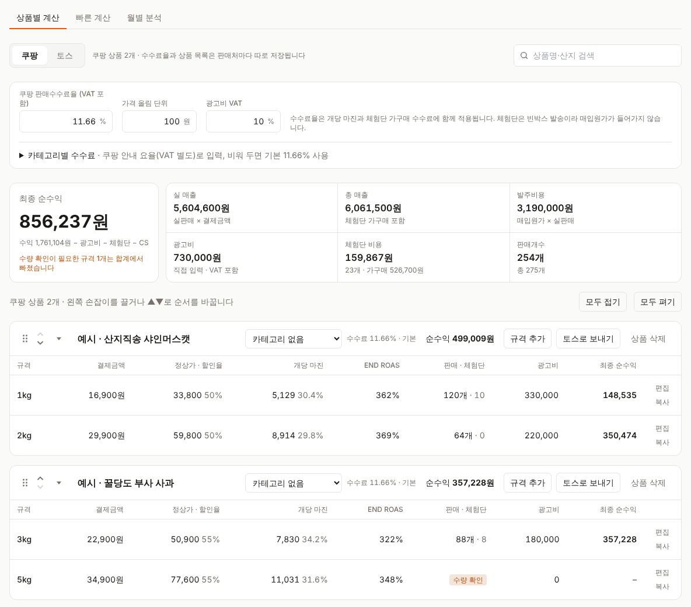

- 위쪽 **쿠팡 / 토스** 버튼으로 판매처를 고르고, 판매처마다 판매수수료율을 따로 넣습니다.
- 상단 카드에 전체 최종 순수익, 실 매출, 발주비용, 광고비, 체험단 비용이 모입니다.
- 판매처 버튼 줄 오른쪽 끝의 **검색창**에 상품명(또는 규격·산지 이름)을 넣으면 맞는 상품만 보입니다. 띄어쓰기와 대소문자는 무시하고, 위쪽 합계 카드는 검색과 상관없이 전체 기준입니다.
- 상품 제목 왼쪽의 **▸ 버튼**으로 규격 표를 접었다 펼 수 있고, 목록 위 **모두 접기 / 모두 펴기**로 한 번에 바꿉니다. 접으면 제목 줄에 규격 수와 순수익만 남습니다.
- 품목 순서는 제목 왼쪽 **손잡이(⋮⋮)를 끌어** 원하는 자리에 놓거나 **▲▼ 버튼**으로 한 칸씩 옮깁니다. 접힌 상태와 순서는 저장되고, 검색 중에는 순서를 바꿀 수 없습니다.
- 상품 카드의 **토스로 보내기 / 쿠팡으로 보내기**로 상품을 다른 판매처에 복사합니다. 상품명·규격·산지·매입원가·목표 결제금액·쿠폰 설정은 그대로 옮기고, 판매처마다 다른 판매량·체험단·광고비·CS와 쿠팡 옵션 ID는 비웁니다. 받는 쪽에 같은 이름의 상품이 있으면 한 번 더 확인합니다.
- 상품 카드마다 규격별 결제금액, 정상가·할인율, 개당 마진, END ROAS, 최종 순수익이 보입니다. 체험단개수가 총판매개수보다 많으면 **수량 확인**으로 표시하고 합계에서 뺍니다.

### 2. 규격 편집

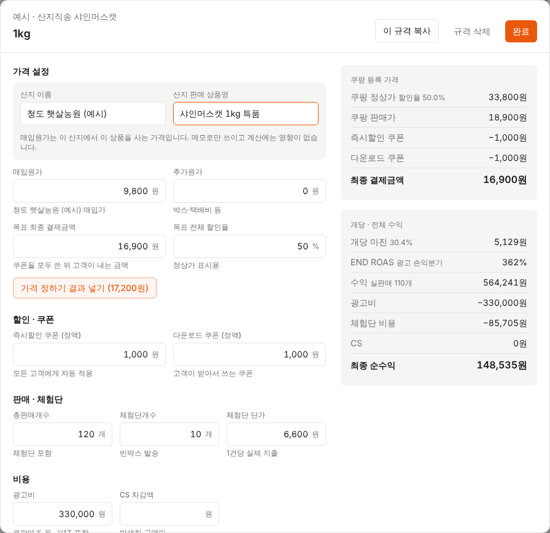

- 헤더의 **상품 추가**를 누르면 이 창이 열리고 맨 위 **상품명** 칸에 바로 입력할 수 있습니다(Tab으로 규격 칸 이동). 상품명은 이 창이나 상품 카드 제목에서 언제든 고칩니다.
- **이 규격 복사**(또는 상품 표 행의 **복사**)를 누르면 원가·판매가·쿠폰·산지 등 입력값을 그대로 가진 규격이 바로 아래에 생기고 규격 칸에 커서가 갑니다. 쿠팡 옵션 ID, 판매·광고 실적, 가격 변동 기록은 복사하지 않습니다.
- 표에서 규격 행을 누르면 열립니다. 왼쪽에 입력하면 오른쪽 쿠팡 등록 가격과 수익이 바로 바뀝니다.
- **가격 설정** 맨 위에 **산지 이름**과 **산지 판매 상품명**을 메모로 적어 둘 수 있습니다. 매입원가가 어느 산지의 어떤 상품 가격인지 남겨 두는 용도로, 계산에는 영향이 없습니다. 상품 표의 규격 아래에도 표시되고 엑셀 내보내기·불러오기에 함께 들어갑니다.
- 가격 정하기 패널에서 가격을 정해 두면 목표 최종 결제금액 아래에 **가격 정하기 결과 넣기** 버튼이 생깁니다. 누르면 그 가격이 바로 들어가고, 이미 같은 가격이면 "적용됨"으로 표시됩니다.
- **가격 변동 기록**: 원물 원가나 판매가·쿠폰이 바뀌면 편집 창 아래 **가격 변동 기록하기**에서 적용일·새 원가·판매가·쿠폰·산지·메모를 넣습니다. 지금 가격은 '이전 가격'으로 남고 새 값이 현재 가격이 됩니다. 이때 지금까지 입력한 판매량·체험단·광고비·CS를 이전 가격 구간 실적으로 옮길 수 있어서, 예전 가격으로 팔린 순수익이 그대로 남습니다. **판매분석 자료로 판매량 채우기**를 누르면 월별 분석에 올린 쿠팡 상품별 판매분석 자료에서 이 규격(연결된 쿠팡 옵션 ID)의 판매량을 가격 구간 날짜에 맞춰 가져옵니다. 채우기 전에 구간별로 '지금 값 → 새 값'을 미리 보여주고, 판매분석 파일 기간이 구간 날짜에 걸치면 기간별 파일의 날짜별 판매 비중으로 나눠 '추정'으로 표시합니다. 같은 옵션 ID가 여러 규격에 연결되어 있으면 판매량이 겹치므로 먼저 가격 묶음 합치기를 하라고 안내합니다. 편집 창의 **총판매개수는 모든 가격 구간을 합한 개수**로 넣고, 현재 가격 구간의 판매량은 총판매개수에서 이전 구간 판매량을 뺀 값으로 자동 계산됩니다(예: 총 9개, 이전 1개 → 현재 8개). 가격 변동 기록 표에서는 이전 구간의 **판매량**과 구간마다의 **체험단·광고비·CS**를 직접 넣고 고칠 수 있고, 구간별 순수익과 전체 구간 합계(상품 표의 순수익과 같음)가 보입니다. 상품 표에는 "원가 ▲700 · 판매가 ▼1,000 · 11/20~"처럼 최근 변동이 표시되고, 월별 분석은 그 달에 해당하는 가격 구간(한 달 안에서 바뀌면 일수 비율)의 원가로 계산합니다.
- **가격 묶음 합치기**: 같은 이름의 상품이 여럿이거나 한 상품 안에 같은 규격이 여러 줄이면(엑셀에서 가격별로 나눠 둔 경우) 목록 위에 **가격 묶음 합치기** 버튼이 생깁니다. 규격마다 마지막 줄이 현재 가격, 앞 줄들이 판매 실적과 함께 이전 가격 구간이 되고, 순수익 합계는 바뀌지 않습니다. 묶음에 날짜가 없었다면 구간 시작일을 나중에 넣어 주세요.
- **쿠팡 연결 · 적용 기간**에 쿠팡 옵션 ID와 가격 적용 기간을 넣으면 월별 분석에서 그 달의 매입원가와 쿠폰 설정을 씁니다.

### 2-1. 가격 변동 기록

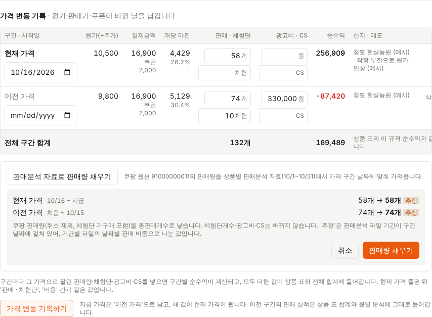

- 원가·판매가·쿠폰이 바뀌면 **가격 변동 기록하기**로 적용일과 새 값을 남깁니다. 지금 가격은 '이전 가격' 구간으로 남습니다.
- 총판매개수는 모든 구간의 합계로 넣습니다. 현재 가격 줄의 판매량은 '총판매개수 − 이전 구간 판매량'으로 자동 계산되고, 이전 구간의 판매량과 구간마다의 체험단·광고비·CS는 표에서 넣습니다. 구간별 순수익과 전체 구간 합계가 계산됩니다.
- **판매분석 자료로 판매량 채우기**는 쿠팡 상품별 판매분석 자료에서 구간 날짜에 맞는 판매량을 가져옵니다. 채우기 전에 '지금 값 → 새 값'을 보여주고, 파일 기간이 구간에 걸치면 '추정'으로 표시합니다.

### 3. 가격 정하기 (오른쪽 패널)

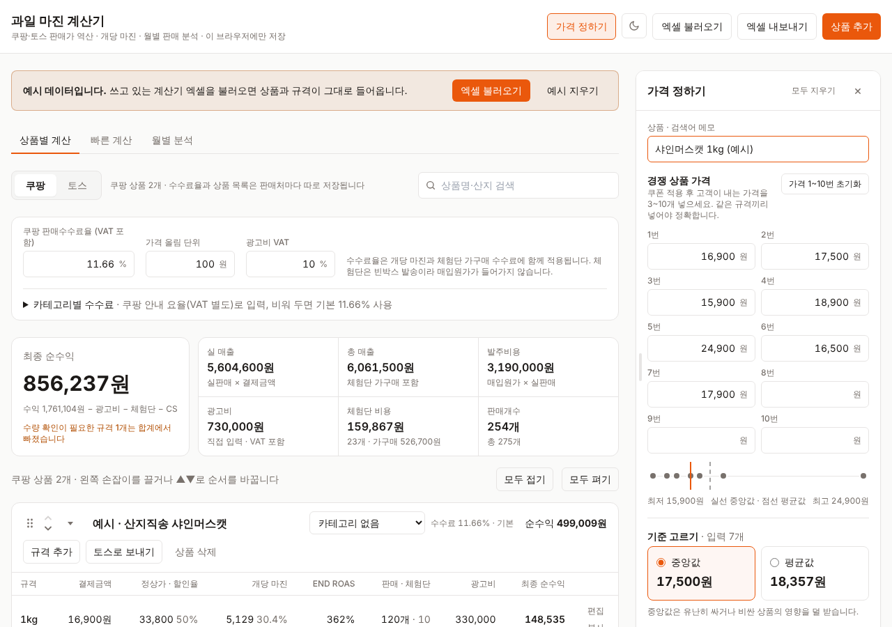

- 헤더의 **가격 정하기** 버튼으로 엽니다. 처음에는 닫혀 있고, 마지막으로 열거나 닫은 상태를 기억합니다. 넓은 화면에서는 본문 바로 오른쪽에 붙어 스크롤해도 따라오고, 휴대폰처럼 좁은 화면에서는 화면을 덮는 서랍으로 열립니다(바깥을 누르거나 Esc로 닫기).
- 패널 왼쪽 가장자리를 끌면 너비를 300~760px 사이에서 바꿀 수 있고, 마지막 너비를 기억합니다. 두 번 누르면 기본 너비로 돌아가고, 가장자리를 선택한 뒤 ←/→ 키로도 조절합니다. 패널이 넓어지면 가격 칸이 3~5열로 늘어납니다.
- 비교할 상품의 가격(쿠폰 적용 후 고객이 내는 가격)을 3~10개 넣습니다. 2개 이하이면 계산하지 않습니다. **가격 1~10번 초기화**로 가격 칸만 한 번에 비울 수 있습니다.
- 판매처·수수료와 상관없이 입력한 가격은 하나로 저장됩니다.
- **중앙값 / 평균값** 중 기준을 고르고, 필요하면 조정 금액(예: −300원)을 더합니다. 고른 **반올림 단위**(10·100·1,000원)로 반올림한 값이 목표 최종 결제금액이 됩니다.
- 아래 그래프에서 입력한 가격 분포와 중앙값(실선)·평균값(점선) 위치를 확인할 수 있습니다.
- **빠른 계산에 넣기**, **이 규격의 목표 결제금액으로 넣기**, 또는 규격 편집 창의 **가격 정하기 결과 넣기**로 적용합니다. 규격 목록에는 쿠팡·토스 상품이 함께 나옵니다.

### 4. 빠른 계산

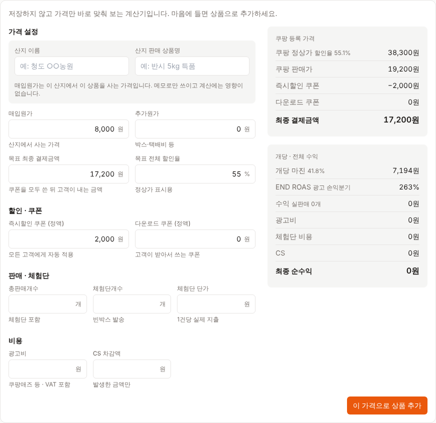

- 저장하지 않고 원가와 가격만 넣어 판매가, 쿠폰 차감, 개당 마진을 바로 봅니다. 마음에 들면 **이 가격으로 상품 추가**를 누릅니다.

### 5. 월별 분석: 판매분석 파일 올리기

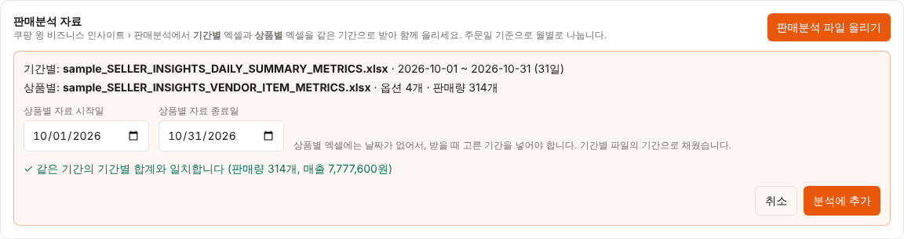

- 쿠팡 판매분석의 **기간별**·**상품별** 엑셀을 함께 고르면 종류를 알아서 구분합니다.
- 상품별 엑셀에는 날짜가 없어서 기간별 파일의 기간을 그대로 쓰고, 두 파일의 합계가 같으면 **일치**로 표시합니다.

### 6. 옵션 연결

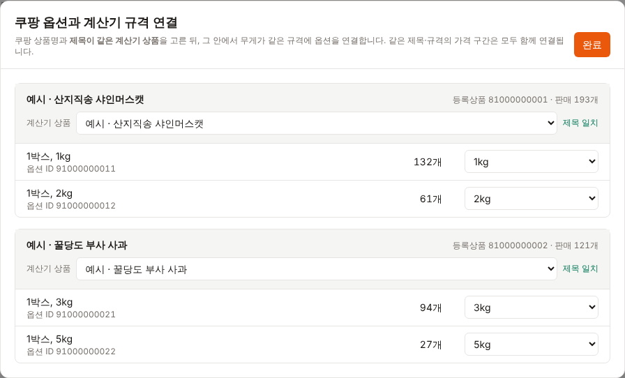

- 쿠팡 상품명과 **제목이 같은 계산기 상품**을 고르고, 그 안에서 무게(kg)가 같은 규격에 옵션을 연결합니다. 옵션은 무게 순으로 정렬됩니다.
- **제목 같은 옵션 모두 연결**로 한 번에 연결하고, 제목이 조금 다른 상품은 **이 제목으로 연결**을 눌러 확인 후 연결합니다.

### 7. 월별 요약과 일별 매출

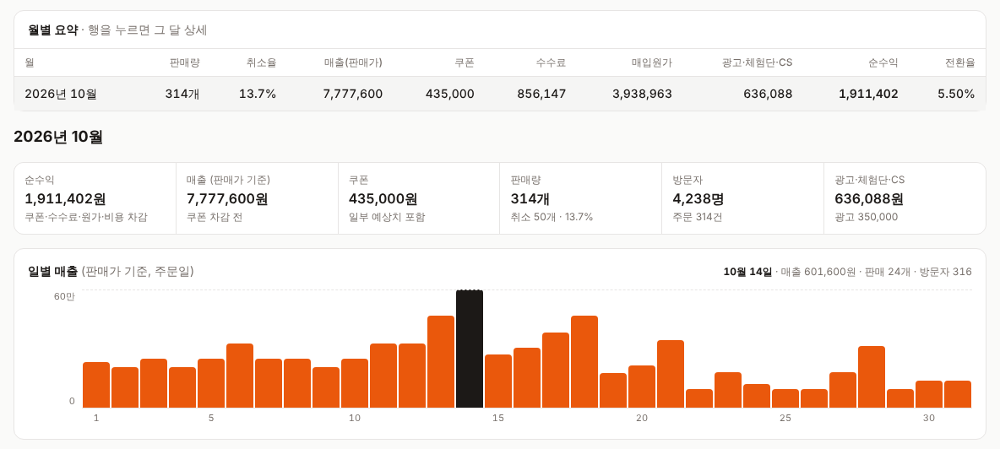

- 달마다 판매량, 취소율, 매출(판매가 기준), 쿠폰, 수수료, 매입원가, 광고·체험단·CS, 순수익, 전환율을 한 줄로 보여줍니다. 행을 누르면 그 달 상세가 열립니다.
- 일별 매출 막대에 마우스를 올리면 그날의 매출, 판매량, 방문자가 보입니다. 취소가 더 많았던 날은 빨간 막대로 아래쪽에 표시됩니다.

### 8. 상품별 순수익

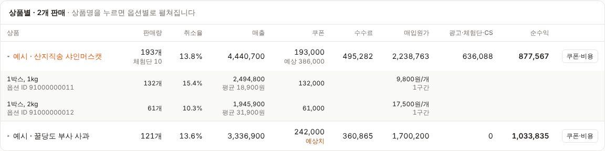

- 상품마다 판매량, 취소율, 매출, 쿠폰, 수수료, 매입원가, 순수익을 보여줍니다. 상품명을 누르면 옵션별로 펼쳐집니다.
- 쿠폰을 입력하지 않은 상품은 계산기 쿠폰 설정 × 판매량으로 추정하고 **예상치**로 표시합니다.

### 9. 쿠폰과 비용 입력

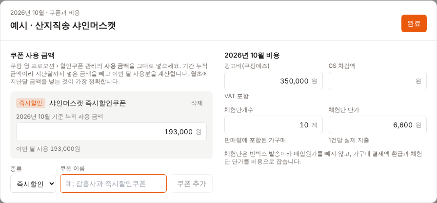

- 상품 행의 **쿠폰·비용**에서 쿠폰을 추가하고, 쿠팡 할인쿠폰 관리의 **누적 사용 금액**을 넣습니다. 지난달까지 넣은 금액을 빼서 그 달 사용분을 계산합니다.
- 그 달의 광고비, CS, 체험단 개수와 단가도 함께 넣습니다.

### 10. 휴대폰 · 다크 모드

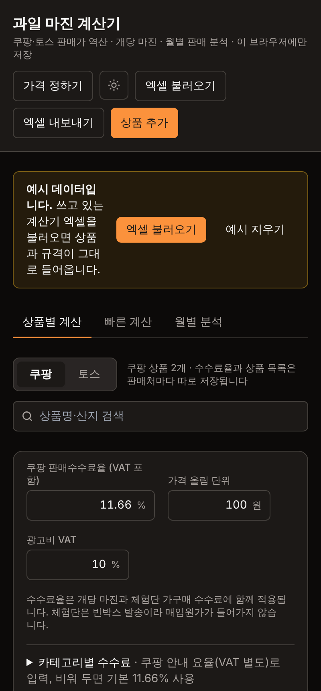

- 휴대폰 크기에서도 쓸 수 있고, 오른쪽 위 버튼으로 다크 모드를 켜고 끕니다.

## 데이터 저장과 백업

- 입력한 데이터는 **이 브라우저 안(localStorage)에만** 저장됩니다. 서버로 보내지 않고, 이 저장소에도 들어가지 않습니다.
- 브라우저 데이터를 지우면 함께 지워집니다. 화면 맨 아래 **백업 저장**으로 JSON 파일을 받아 두세요.
- 다른 브라우저나 컴퓨터로 옮길 때는 **백업 저장** 후 그쪽에서 **백업 불러오기**를 하면 됩니다.

## 월별 분석에 올리는 파일

쿠팡 윙 **비즈니스 인사이트 › 판매분석**에서 같은 기간으로 두 파일을 받아 함께 올립니다.

| 파일 | 내용 |
|---|---|
| 기간별 (`SELLER_INSIGHTS_DAILY_SUMMARY_METRICS`) | 날짜별 방문자, 주문, 판매량, 매출 |
| 상품별 (`SELLER_INSIGHTS_VENDOR_ITEM_METRICS`) | 옵션별 판매량, 매출, 취소 (날짜 없음) |

- 상품별 파일에는 날짜가 없어서, 기간별 파일의 기간을 그대로 씁니다. 두 파일의 합계가 같으면 "일치"로 표시됩니다.
- 여러 달에 걸친 상품별 파일은 기간별 파일의 날짜별 판매 비중으로 나눠 "배분 추정"으로 표시합니다. **상품별 파일을 매달 1일~말일로 받으면** 추정 없이 정확합니다.
- 처음 한 번 **옵션 연결**에서 쿠팡 옵션을 계산기 규격에 연결합니다. 쿠팡 상품명과 제목이 같은 계산기 상품 안에서 무게(kg)가 같은 규격에 자동으로 짝지어집니다.
- 쿠폰은 쿠팡 윙 **프로모션 › 할인쿠폰 관리**의 "사용 금액"(누적)을 상품별 **쿠폰·비용**에 넣습니다. 지난달까지 넣은 누적 금액을 빼서 그 달 사용분을 계산합니다. 넣지 않으면 계산기 쿠폰 설정 × 판매량으로 추정합니다.

## 계산 방식

- 쿠팡 판매가 = 목표 결제금액 + 즉시할인 쿠폰 + 다운로드 쿠폰 (가격 단위로 올림)
- 최종 결제금액 = 판매가 − 즉시할인 쿠폰 − 다운로드 쿠폰
- 개당 마진 = 결제금액 × (1 − 판매수수료율) − 매입원가 − 추가원가
- 실제 판매개수 = 총판매개수 − 체험단개수, 수익 = 실제 판매개수 × 개당 마진
- 체험단 비용 = 체험단개수 × (체험단 단가 + 결제금액 × 수수료율). 빈박스 발송이라 매입원가는 넣지 않습니다.
- 최종 순수익 = 수익 − 광고비 − 체험단 비용 − CS
- END ROAS = 결제금액 ÷ 개당 마진 × (1 + 광고비 VAT)

## 폴더 구조

```
index.html            계산기 전체 (화면 + 계산 로직)
assets/tailwind.css   미리 빌드한 화면 스타일
vendor/               React 18.3.1, htm 3.1.1, SheetJS 0.18.5 (오프라인 동작용)
docs/screenshots/     README 스크린샷 (예시 데이터)
LICENSE               MIT 라이선스 (라이브러리 라이선스는 vendor/LICENSE-*.txt)
```

## 화면 스타일을 고칠 때

`index.html`의 class를 바꿨다면 스타일을 다시 빌드해야 반영됩니다.

```bash
npm install
npm run build:css
```

## 저작권과 라이선스

Copyright (c) 2026 parkminhong

이 계산기는 [MIT 라이선스](LICENSE)로 공개합니다.

- 누구나 자유롭게 쓰고, 고치고, 다시 배포하고, 상업적으로도 쓸 수 있습니다.
- 다만 복사하거나 고쳐서 배포할 때는 위 저작권 표시와 [LICENSE](LICENSE) 내용을 함께 넣어야 합니다.
- 계산 결과는 참고용입니다. 계산기를 써서 생긴 손실이나 문제에 대해 저작자는 책임지지 않습니다. 수수료율과 정산 금액은 쿠팡·토스의 실제 안내로 꼭 확인하세요.
- 스크린샷의 상품명과 숫자는 모두 예시입니다. 쿠팡·토스 등 상표와 이름은 각 회사의 것입니다.

### 함께 들어 있는 라이브러리

`vendor/` 폴더의 라이브러리는 이 저장소의 MIT 라이선스가 아니라 각자의 라이선스를 따릅니다. 라이선스 전문은 `vendor/LICENSE-*.txt`에 있습니다.

- [React](https://react.dev) 18.3.1 (MIT)
- [htm](https://github.com/developit/htm) 3.1.1 (Apache-2.0)
- [SheetJS Community Edition](https://sheetjs.com) 0.18.5 (Apache-2.0)
