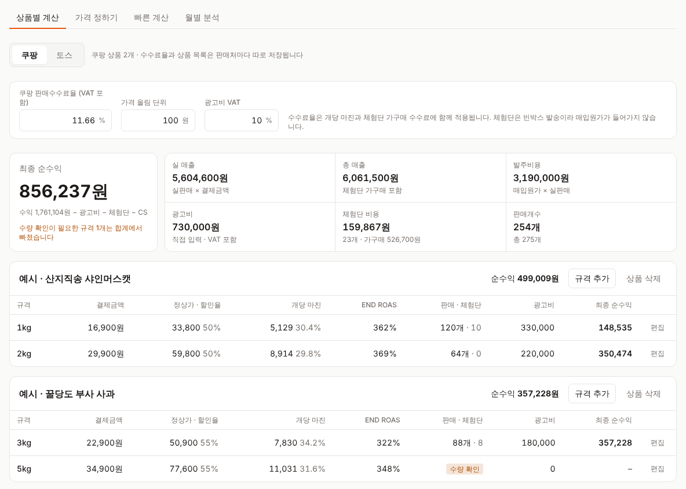
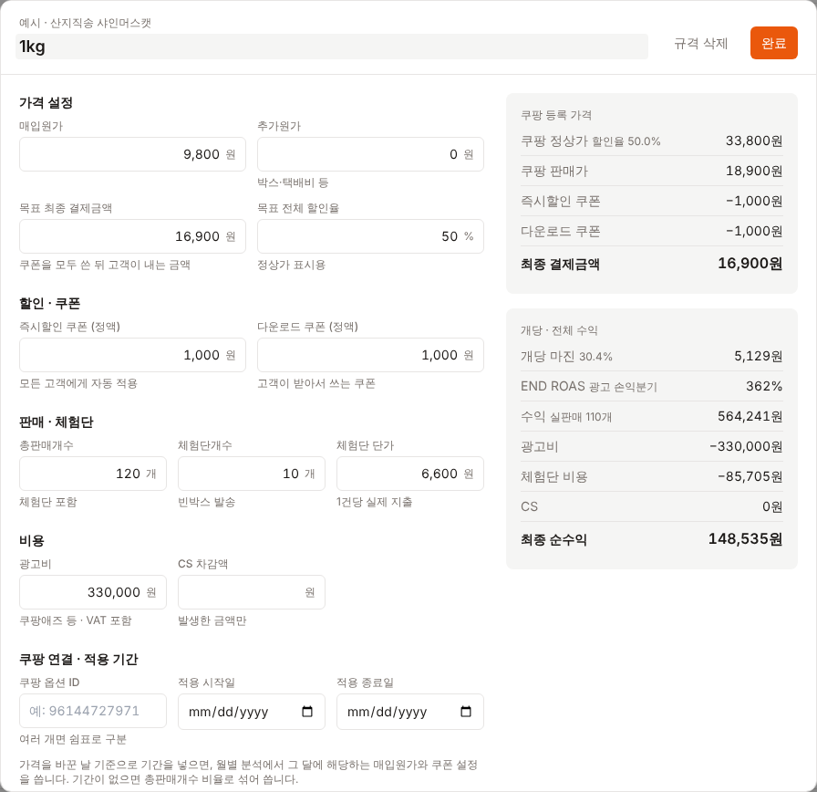
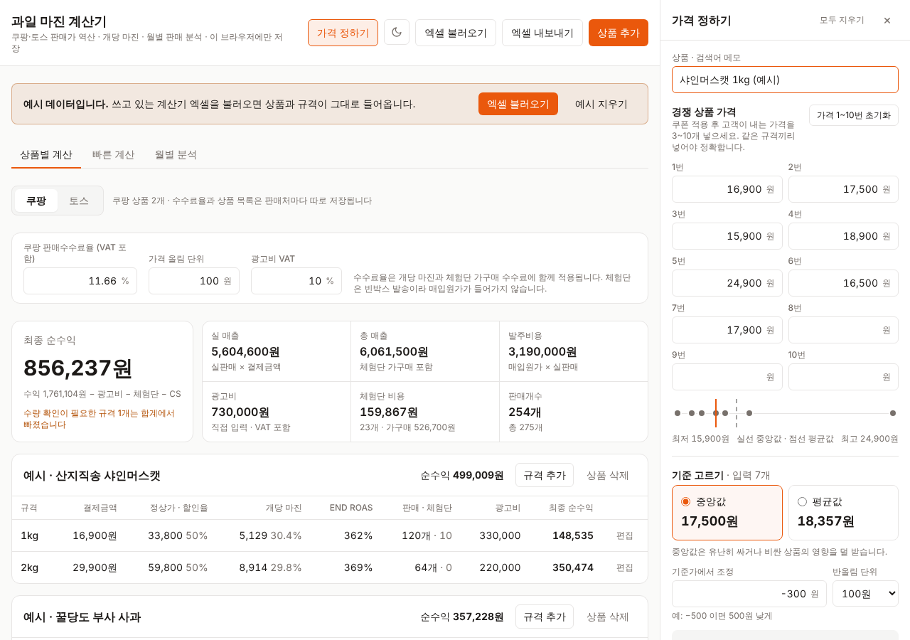
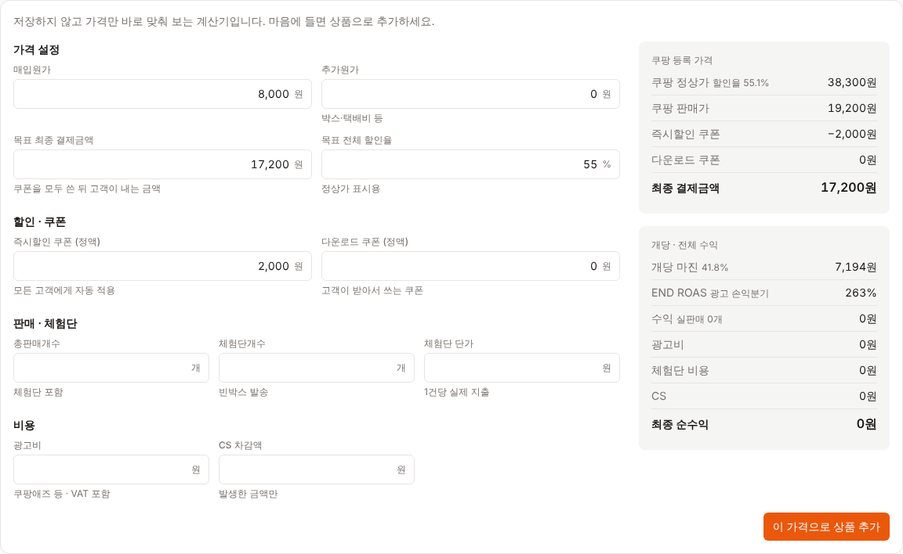
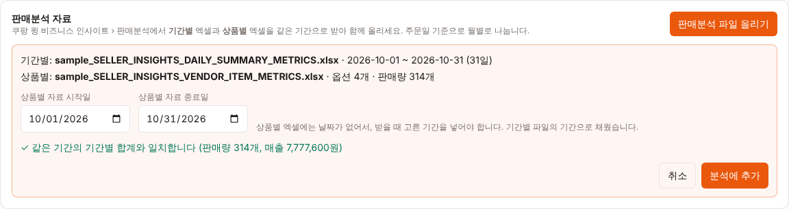
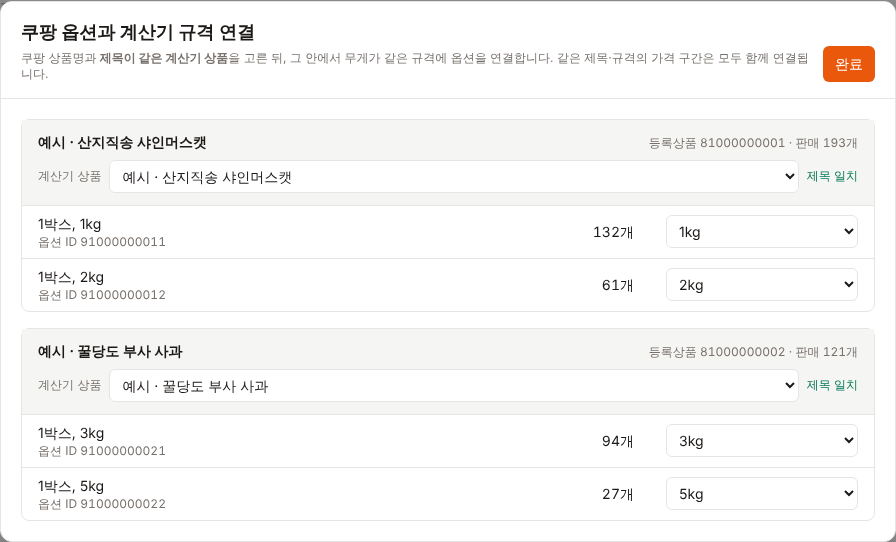
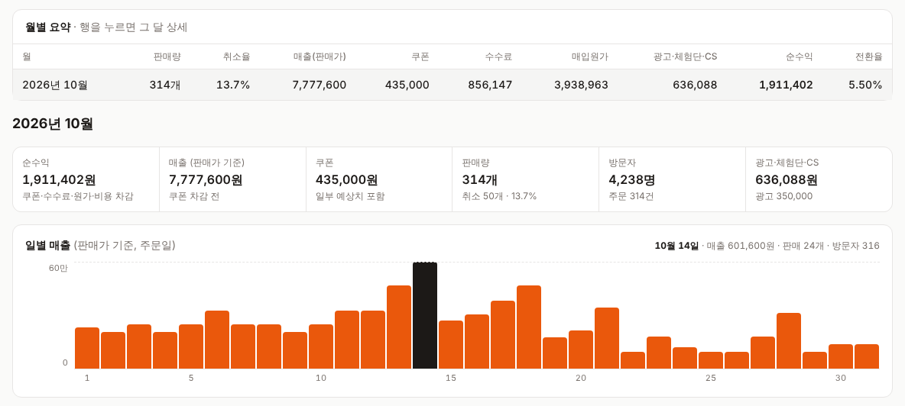
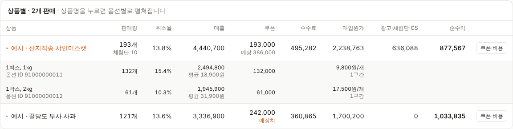
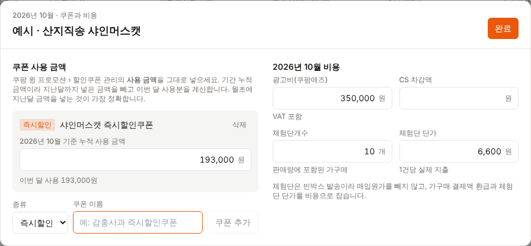
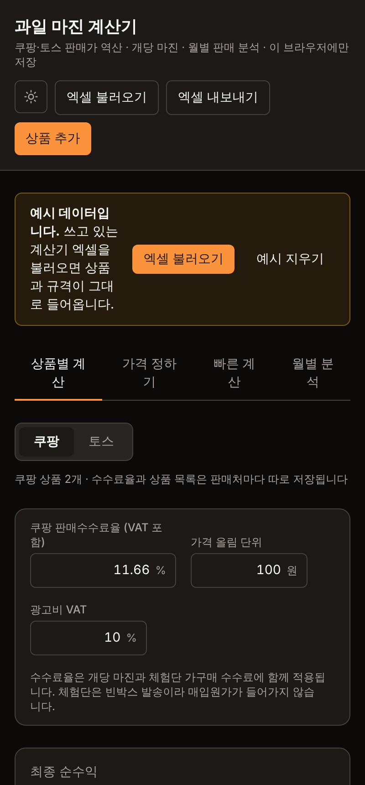

# 과일 마진 계산기

쿠팡·토스에 파는 과일 상품의 판매가를 역산하고, 개당 마진과 광고·체험단·CS를 뺀 순수익을 계산합니다.
쿠팡 판매분석 엑셀을 올리면 주문일 기준으로 월별 판매량, 쿠폰, 순수익을 정리해 줍니다.

설치나 서버 없이 `index.html`을 브라우저로 열면 바로 동작하고, 인터넷 연결이 없어도 됩니다.

## 실행 방법

1. 이 저장소에서 **Code → Download ZIP**으로 내려받아 압축을 풉니다. (또는 `git clone`)
2. 폴더 안의 `index.html`을 더블클릭해 엽니다. Chrome 또는 Edge를 권장합니다.

## 기능

| 화면 | 하는 일 |
|---|---|
| 상품별 계산 | 상품·규격별로 매입원가, 목표 결제금액, 즉시할인 쿠폰·다운로드 쿠폰(정액)을 넣으면 쿠팡 판매가·정상가·개당 마진·END ROAS·최종 순수익을 계산합니다. |
| 빠른 계산 | 저장하지 않고 가격만 맞춰 봅니다. 마음에 들면 상품으로 추가합니다. |
| 월별 분석 | 쿠팡 판매분석 엑셀(기간별 + 상품별)을 올리면 주문일 기준으로 월별로 나눠 판매량, 취소율, 쿠폰, 수수료, 매입원가, 순수익을 보여줍니다. |
| 가격 정하기 (오른쪽 패널) | 헤더의 **가격 정하기** 버튼으로 열고 닫는 패널입니다. 어느 탭에서든 옆에 띄워 두고, 경쟁 상품 가격 3~10개의 중앙값·평균값으로 목표 결제금액을 정합니다. |

- 상단의 **쿠팡 / 토스** 전환으로 판매처별 상품 목록과 수수료율을 따로 관리합니다. 토스 판매 파일 분석은 아직 없습니다.
- **토스 수수료**는 결제수수료(사업자 등급별: 영세 1.6%, 중소1 1.9%, 중소2 2.15%, 중소3 2.4%, 일반 3%)와 상품판매수수료(8%, CPC 광고 유입 상품은 0%)를 더해 계산합니다. 토스쇼핑 판매자 가이드의 요율은 **VAT 별도**라서 "부가세 10% 더하기"가 기본으로 켜져 있습니다(예: 중소1 = (1.9% + 8%) × 1.1 = 10.89%). 등급은 1년에 두 번 자동 갱신되고, 정산은 구매확정일 D+2 영업일입니다. CPC 광고 유입 0%는 윈들리(windly.cc) 정리 기준입니다.
- **엑셀 불러오기 / 내보내기**로 계산기 엑셀과 주고받을 수 있습니다.
- 오른쪽 위 버튼으로 다크 모드를 켜고 끕니다.

## 화면 둘러보기

> 스크린샷의 상품과 판매 숫자는 모두 예시입니다.

### 1. 상품별 계산



- 위쪽 **쿠팡 / 토스** 버튼으로 판매처를 고르고, 판매처마다 판매수수료율을 따로 넣습니다.
- 상단 카드에 전체 최종 순수익, 실 매출, 발주비용, 광고비, 체험단 비용이 모입니다.
- 판매처 버튼 줄 오른쪽 끝의 **검색창**에 상품명(또는 규격·산지 이름)을 넣으면 맞는 상품만 보입니다. 띄어쓰기와 대소문자는 무시하고, 위쪽 합계 카드는 검색과 상관없이 전체 기준입니다.
- 상품 카드의 **토스로 보내기 / 쿠팡으로 보내기**로 상품을 다른 판매처에 복사합니다. 상품명·규격·산지·매입원가·목표 결제금액·쿠폰 설정은 그대로 옮기고, 판매처마다 다른 판매량·체험단·광고비·CS와 쿠팡 옵션 ID는 비웁니다. 받는 쪽에 같은 이름의 상품이 있으면 한 번 더 확인합니다.
- 상품 카드마다 규격별 결제금액, 정상가·할인율, 개당 마진, END ROAS, 최종 순수익이 보입니다. 체험단개수가 총판매개수보다 많으면 **수량 확인**으로 표시하고 합계에서 뺍니다.

### 2. 규격 편집



- 표에서 규격 행을 누르면 열립니다. 왼쪽에 입력하면 오른쪽 쿠팡 등록 가격과 수익이 바로 바뀝니다.
- **가격 설정** 맨 위에 **산지 이름**과 **산지 판매 상품명**을 메모로 적어 둘 수 있습니다. 매입원가가 어느 산지의 어떤 상품 가격인지 남겨 두는 용도로, 계산에는 영향이 없습니다. 상품 표의 규격 아래에도 표시되고 엑셀 내보내기·불러오기에 함께 들어갑니다.
- 가격 정하기 패널에서 가격을 정해 두면 목표 최종 결제금액 아래에 **가격 정하기 결과 넣기** 버튼이 생깁니다. 누르면 그 가격이 바로 들어가고, 이미 같은 가격이면 "적용됨"으로 표시됩니다.
- **쿠팡 연결 · 적용 기간**에 쿠팡 옵션 ID와 가격 적용 기간을 넣으면 월별 분석에서 그 달의 매입원가와 쿠폰 설정을 씁니다.

### 3. 가격 정하기 (오른쪽 패널)



- 헤더의 **가격 정하기** 버튼으로 엽니다. 처음에는 닫혀 있고, 마지막으로 열거나 닫은 상태를 기억합니다. 넓은 화면에서는 본문 바로 오른쪽에 붙어 스크롤해도 따라오고, 휴대폰처럼 좁은 화면에서는 화면을 덮는 서랍으로 열립니다(바깥을 누르거나 Esc로 닫기).
- 패널 왼쪽 가장자리를 끌면 너비를 300~760px 사이에서 바꿀 수 있고, 마지막 너비를 기억합니다. 두 번 누르면 기본 너비로 돌아가고, 가장자리를 선택한 뒤 ←/→ 키로도 조절합니다. 패널이 넓어지면 가격 칸이 3~5열로 늘어납니다.
- 비교할 상품의 가격(쿠폰 적용 후 고객이 내는 가격)을 3~10개 넣습니다. 2개 이하이면 계산하지 않습니다. **가격 1~10번 초기화**로 가격 칸만 한 번에 비울 수 있습니다.
- 판매처·수수료와 상관없이 입력한 가격은 하나로 저장됩니다.
- **중앙값 / 평균값** 중 기준을 고르고, 필요하면 조정 금액(예: −300원)을 더합니다. 고른 **반올림 단위**(10·100·1,000원)로 반올림한 값이 목표 최종 결제금액이 됩니다.
- 아래 그래프에서 입력한 가격 분포와 중앙값(실선)·평균값(점선) 위치를 확인할 수 있습니다.
- **빠른 계산에 넣기**, **이 규격의 목표 결제금액으로 넣기**, 또는 규격 편집 창의 **가격 정하기 결과 넣기**로 적용합니다. 규격 목록에는 쿠팡·토스 상품이 함께 나옵니다.

### 4. 빠른 계산



- 저장하지 않고 원가와 가격만 넣어 판매가, 쿠폰 차감, 개당 마진을 바로 봅니다. 마음에 들면 **이 가격으로 상품 추가**를 누릅니다.

### 5. 월별 분석: 판매분석 파일 올리기



- 쿠팡 판매분석의 **기간별**·**상품별** 엑셀을 함께 고르면 종류를 알아서 구분합니다.
- 상품별 엑셀에는 날짜가 없어서 기간별 파일의 기간을 그대로 쓰고, 두 파일의 합계가 같으면 **일치**로 표시합니다.

### 6. 옵션 연결



- 쿠팡 상품명과 **제목이 같은 계산기 상품**을 고르고, 그 안에서 무게(kg)가 같은 규격에 옵션을 연결합니다. 옵션은 무게 순으로 정렬됩니다.
- **제목 같은 옵션 모두 연결**로 한 번에 연결하고, 제목이 조금 다른 상품은 **이 제목으로 연결**을 눌러 확인 후 연결합니다.

### 7. 월별 요약과 일별 매출



- 달마다 판매량, 취소율, 매출(판매가 기준), 쿠폰, 수수료, 매입원가, 광고·체험단·CS, 순수익, 전환율을 한 줄로 보여줍니다. 행을 누르면 그 달 상세가 열립니다.
- 일별 매출 막대에 마우스를 올리면 그날의 매출, 판매량, 방문자가 보입니다. 취소가 더 많았던 날은 빨간 막대로 아래쪽에 표시됩니다.

### 8. 상품별 순수익



- 상품마다 판매량, 취소율, 매출, 쿠폰, 수수료, 매입원가, 순수익을 보여줍니다. 상품명을 누르면 옵션별로 펼쳐집니다.
- 쿠폰을 입력하지 않은 상품은 계산기 쿠폰 설정 × 판매량으로 추정하고 **예상치**로 표시합니다.

### 9. 쿠폰과 비용 입력



- 상품 행의 **쿠폰·비용**에서 쿠폰을 추가하고, 쿠팡 할인쿠폰 관리의 **누적 사용 금액**을 넣습니다. 지난달까지 넣은 금액을 빼서 그 달 사용분을 계산합니다.
- 그 달의 광고비, CS, 체험단 개수와 단가도 함께 넣습니다.

### 10. 휴대폰 · 다크 모드



- 휴대폰 크기에서도 쓸 수 있고, 오른쪽 위 버튼으로 다크 모드를 켜고 끕니다.

## 데이터 저장과 백업

- 입력한 데이터는 **이 브라우저 안(localStorage)에만** 저장됩니다. 서버로 보내지 않고, 이 저장소에도 들어가지 않습니다.
- 브라우저 데이터를 지우면 함께 지워집니다. 화면 맨 아래 **백업 저장**으로 JSON 파일을 받아 두세요.
- 다른 브라우저나 컴퓨터로 옮길 때는 **백업 저장** 후 그쪽에서 **백업 불러오기**를 하면 됩니다.

## 월별 분석에 올리는 파일

쿠팡 윙 **비즈니스 인사이트 › 판매분석**에서 같은 기간으로 두 파일을 받아 함께 올립니다.

| 파일 | 내용 |
|---|---|
| 기간별 (`SELLER_INSIGHTS_DAILY_SUMMARY_METRICS`) | 날짜별 방문자, 주문, 판매량, 매출 |
| 상품별 (`SELLER_INSIGHTS_VENDOR_ITEM_METRICS`) | 옵션별 판매량, 매출, 취소 (날짜 없음) |

- 상품별 파일에는 날짜가 없어서, 기간별 파일의 기간을 그대로 씁니다. 두 파일의 합계가 같으면 "일치"로 표시됩니다.
- 여러 달에 걸친 상품별 파일은 기간별 파일의 날짜별 판매 비중으로 나눠 "배분 추정"으로 표시합니다. **상품별 파일을 매달 1일~말일로 받으면** 추정 없이 정확합니다.
- 처음 한 번 **옵션 연결**에서 쿠팡 옵션을 계산기 규격에 연결합니다. 쿠팡 상품명과 제목이 같은 계산기 상품 안에서 무게(kg)가 같은 규격에 자동으로 짝지어집니다.
- 쿠폰은 쿠팡 윙 **프로모션 › 할인쿠폰 관리**의 "사용 금액"(누적)을 상품별 **쿠폰·비용**에 넣습니다. 지난달까지 넣은 누적 금액을 빼서 그 달 사용분을 계산합니다. 넣지 않으면 계산기 쿠폰 설정 × 판매량으로 추정합니다.

## 계산 방식

- 쿠팡 판매가 = 목표 결제금액 + 즉시할인 쿠폰 + 다운로드 쿠폰 (가격 단위로 올림)
- 최종 결제금액 = 판매가 − 즉시할인 쿠폰 − 다운로드 쿠폰
- 개당 마진 = 결제금액 × (1 − 판매수수료율) − 매입원가 − 추가원가
- 실제 판매개수 = 총판매개수 − 체험단개수, 수익 = 실제 판매개수 × 개당 마진
- 체험단 비용 = 체험단개수 × (체험단 단가 + 결제금액 × 수수료율). 빈박스 발송이라 매입원가는 넣지 않습니다.
- 최종 순수익 = 수익 − 광고비 − 체험단 비용 − CS
- END ROAS = 결제금액 ÷ 개당 마진 × (1 + 광고비 VAT)

## 폴더 구조

```
index.html            계산기 전체 (화면 + 계산 로직)
assets/tailwind.css   미리 빌드한 화면 스타일
vendor/               React 18.3.1, htm 3.1.1, SheetJS 0.18.5 (오프라인 동작용)
docs/screenshots/     README 스크린샷 (예시 데이터)
```

## 화면 스타일을 고칠 때

`index.html`의 class를 바꿨다면 스타일을 다시 빌드해야 반영됩니다.

```bash
npm install
npm run build:css
```

## 함께 들어 있는 라이브러리

- [React](https://react.dev) 18.3.1 (MIT)
- [htm](https://github.com/developit/htm) 3.1.1 (Apache-2.0)
- [SheetJS Community Edition](https://sheetjs.com) 0.18.5 (Apache-2.0)
